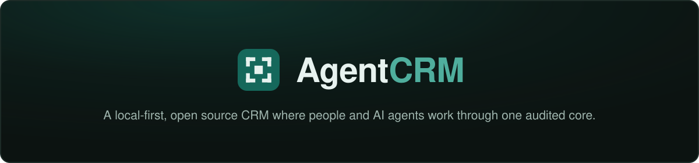
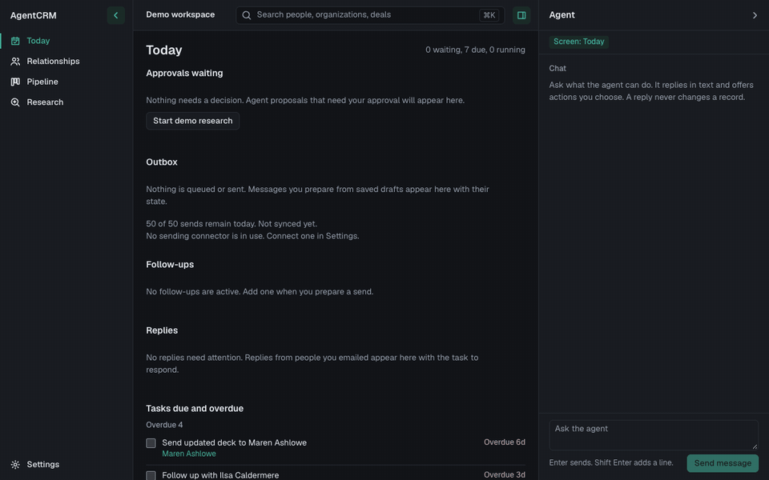
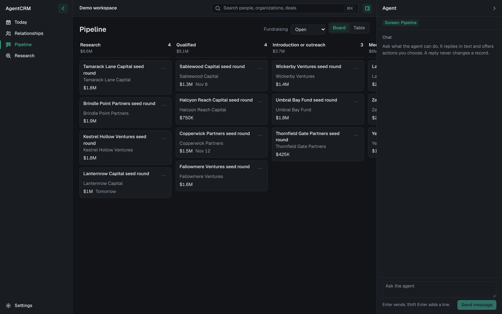
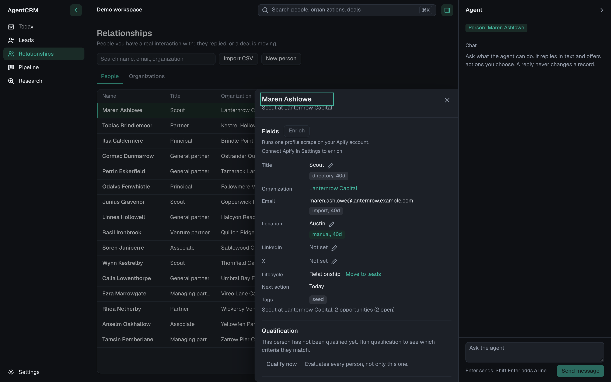
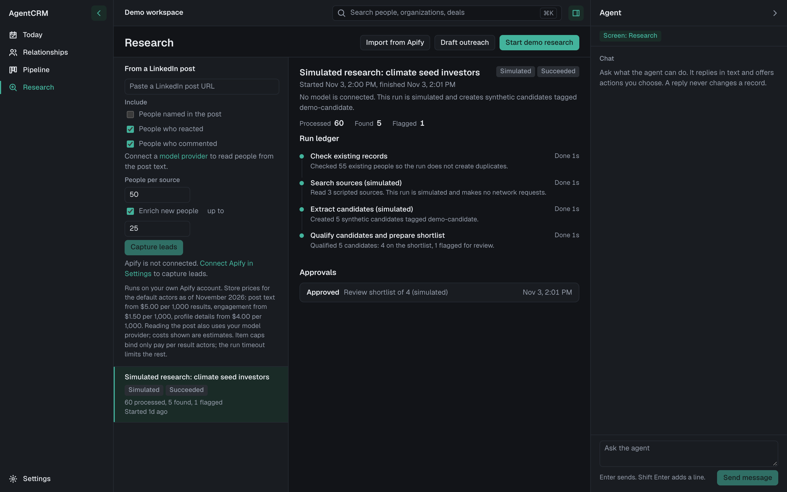

<div align="center">



**The CRM that people and AI agents operate together.**

  

[Quick start](#quick-start) · [What works](#what-works-today) · [Architecture docs](docs/architecture.md)

</div>

<p align="center">
AgentCRM is a local first, open source CRM. People and AI agents work through the same audited core: the web UI, the CLI, and the MCP server all call one action service.<br>
Your data lives in a SQLite file on your own computer.
</p>

> **Status: early development, not yet ready for real work.** The demo data is synthetic. Connector keys are stored unencrypted in a local file that only you can read.

## See it



<table>
  <tr>
    <td width="50%" align="center">
      <br>
      <sub>Pipeline: opportunities by stage, with full stage history.</sub>
    </td>
    <td width="50%" align="center">
      <br>
      <sub>Relationships: people and organizations, searchable, with sources on every fact.</sub>
    </td>
  </tr>
  <tr>
    <td colspan="2" align="center">
      <br>
      <sub>Research: the run ledger with steps, counts, and the approval that gated the result.</sub>
    </td>
  </tr>
</table>

## Why another CRM

Most CRMs treat AI as a chat box bolted onto a database. AgentCRM works the other way around.

- **One audited path.** An agent action goes through the same action service as a human click.
- **Facts keep their receipts.** Every scraped or inferred fact keeps its source and verification status.
- **No approval, no outside effect.** Editing an approved payload invalidates the approval.
- **Useful with no model.** Read, edit, search, and filter all work offline.

Hosted tools such as Attio, Clay, and folk are good products. AgentCRM is a different combination: local first, open source, operable by agents through MCP and a CLI, data in a file you own, and no per seat pricing.

## Quick start

Requires Node.js 22 or newer. No Docker, no accounts, no external services.

```bash
git clone https://github.com/samrusani/AgentCRM.git
cd AgentCRM
npm run setup
npm run seed
npm run dev
```

Open http://127.0.0.1:5173 in your browser. The API listens on http://127.0.0.1:4720. Both bind to loopback only.

Prefer a Mac app over a terminal? `npm install --prefix apps/desktop` once, then `npm run desktop` opens AgentCRM as its own window: the same server running in-process on a port the OS picks, with its database in `~/Library/Application Support/AgentCRM/` (set `AGENTCRM_DB` to use another file, such as this repository's `data/agentcrm.db`). `npm run desktop:pack` builds an unsigned local `AgentCRM.app` for your own machine. A dev stack and the app can run side by side; they only share data if you point them at the same file.

`npm run seed` fills the database with clearly synthetic demo data: fictional investors, funds, and companies. All demo names are invented, and any resemblance to a real person or organization is coincidental. Seeding replaces records only: your settings, connectors, and the extension's capture token survive it.

## Built for agents

AgentCRM ships an MCP server over stdio. Point Claude Code, Codex, or any MCP client at it and the agent works on the same records you see in the UI.

It exposes 8 tools:

`crm_describe` · `crm_search` · `crm_get_record` · `crm_propose_changes` · `crm_apply_changes` · `crm_start_research` · `start_lead_capture` · `crm_get_run`

- **Propose, then apply.** Writes start as a proposal. You review it, and only then does it apply.
- **No tool can decide an approval.** An agent can ask for one. It cannot grant one.
- **Bounded runs.** Agents can start qualify runs, allowlisted Apify runs, allowlisted lead captures, and budgeted draft runs.

Add it to Claude Code with one line:

```bash
claude mcp add agentcrm -- npm run --silent mcp --prefix apps/server
```

Run it from the repository root, or make the `--prefix` path absolute. Keep `--silent`: it stops npm from writing its own output into the stdio channel the MCP protocol uses. Other MCP clients, Codex included, can launch the same command from their config.

The client spawns the MCP server as a child process per session and it dies with that session. Two consequences: a "Transport closed" error means the process ended (for example it was killed, or the machine slept), and the fix is starting a new client session, which spawns a fresh one; and after updating AgentCRM, start a new client session too, so the agent runs the new code rather than a server spawned before the update. A server you forget to restart notices on its own: it checks before every tool call that the database schema still matches the code it started with, and once the schema has changed (an update ran, or a backup was restored) every tool answers the error `stale_server` naming that same fix, and its job worker stands down so a current process advances runs.

## What works today

Every row below is backed by tests: 3,496 across the server (2,415), the web app (799), and the browser extension (282), plus 7 on the desktop shell's helpers. "Verified against stubbed APIs" means the tests run against a fake provider, not live servers.

### Core CRM

| Area | Status |
| --- | --- |
| Leads and Relationships: imported and captured people start as leads and graduate to relationships when they reply or a deal moves past the first stage, with manual promote and demote; LinkedIn and X profiles as first class fields; the person sheet links a person to an organization through a live search picker that can also create the organization in place | Working, synthetic data |
| Custom attributes: typed fields you define on people and organizations (message angle, fit notes, check sizes ship as defaults), edited like any field and open to agents through the proposal flow, so an agent can research and fill them under your approval | Working |
| Lists: hand curated people lists such as UK Angels or Energy investors, with bulk add from the table, chips on the person sheet, and a list filter on Leads and Relationships; lists never reach agents or model calls | Working |
| Field enrichment: one click runs one scrape and suggests values for empty fields, each accepted or dismissed by you; people by their LinkedIn profile, or by a name search that finds the profile when none is saved and tells you who it found; organizations by their saved page or a name lookup that tells you which company it found | Working, verified against a stubbed Apify API; bring your own Apify account |
| Pipeline: as many pipelines as you need (say a US and a UK investor pipeline), each seeded from a template with its own stages and switchable later without losing its name; opportunities in board and table views with stage history; create deals from the Pipeline header or straight from a person or organization sheet, choosing the pipeline as you go | Working |
| Approvals: review, approve, reject, audit trail | Working |
| Birthdays: a birthday on each person, with or without the year, and a Today card for the next seven days | Working |
| Automations: rules like "when a deal enters Diligence, create a task due in 2 days"; an automation only ever creates a task, never edits records or sends anything, so it cannot loop or surprise | Working |
| Saved views: named shortcuts to the filters you keep returning to on Leads, Relationships, and Pipeline; a view stores only screen state, so it can never show rows the screen's own rules would not | Working |
| Duplicates: a live scan finds people sharing an email, LinkedIn profile, X handle, or name at the same organization, and a guarded merge keeps one record, fills its gaps, moves everything else, and refuses while any follow-up or send is active; dismissing a pair is remembered | Working; merging is permanent, back up first |
| Evidence: field claims with source and verification status | Working, synthetic sources |
| Templates: startup fundraising, fund LP fundraising, client sales, applied per pipeline with a guided switch that maps stages | Working |
| Qualification: editable criteria, per criterion verdicts with evidence, fit sort | Working; unknown never counts as a match |
| Reports: pipeline state and closures, stage flow, weekly intake by source, outreach outcomes, and run spend, all computed live from the local database with estimates labelled as such | Working, read only |
| Backup and restore: consistent snapshots and a guarded restore | Working, CLI |
| Performance: measured against the published budgets at 100,000 people and 1,000,000 activities | 9 of 9 budgets pass; see docs/performance.md |

### Agents and models

| Area | Status |
| --- | --- |
| Agent panel: chat, run progress, approvals | Working; model backed with your own key for Anthropic, OpenAI, DeepSeek, or Z.ai, or a local Ollama server; honest deterministic replies with none |
| Draft outreach: model written drafts with budgets, review before saving | Working, verified against stubbed provider APIs; drafts are never sent |
| Model costs: per call usage rows, per run estimates from list prices | Working, always labelled estimates |
| Research: runs with live steps, counts, and partial results | Simulated demo run only |
| MCP server over stdio | Working, read and propose tools; can start qualify runs, allowlisted Apify runs, allowlisted lead captures, and budgeted draft runs; a database wide worker lease keeps exactly one job worker active, with the API server preferred, so a long lived MCP process never runs steps while the server is up |
| CLI: doctor, seed, serve, search, runs | Working |

### Getting data in

| Area | Status |
| --- | --- |
| Apify imports: run any store Actor, staged rows, dedupe, review before anything is saved | Working, verified against a stubbed Apify API; bring your own Apify account |
| CSV import: column mapping, staged rows, same dedupe and review as Apify | Working, UI and CLI |
| Auto accept imports: an off by default setting saves staged rows from your own imports without review, with the decision still recorded; runs started by the agent always wait | Working |
| LinkedIn lead capture: paste a post URL or a lnkd.in short link (resolved before anything is fetched), read the people and organizations named in the post text, scrape reactions and comments, enrich new people, one review; or paste the post text itself and capture with no Apify account at all | Working, verified against stubbed Apify and model APIs; runs on your own Apify account and model key, and a pasted capture needs only the model |
| Call transcript capture: paste a call transcript and a model reads out the people and organizations it names, each with the verbatim line it was read from; every row waits for your review, nothing unverifiable is ever staged, and the transcript itself never reaches any agent surface | Working, verified against a stubbed model API; needs a connected model provider |
| Mailbox scan: stage the people you already correspond with from mail synced to this computer, with message counts for judging each row; nothing is fetched or billed, every scan waits for your review whatever the auto accept setting, correspondents who wrote to you arrive as relationships, and every person with linked mail shows when you last heard from them and last wrote to them | Working, verified against stored mail fixtures; needs a connected mail provider |
| Browser extension: one click capture of the LinkedIn or X profile you are viewing, with the button sitting next to the profile name and showing In CRM when the person is already saved; token guarded, nothing leaves your machine | Working; load unpacked from apps/extension, generate the token in Settings |

### Email and follow-ups

| Area | Status |
| --- | --- |
| Email: AgentMail, Gmail, Microsoft 365, and IMAP/SMTP (iCloud Mail and Fastmail presets) behind one adapter, reviewed sends with per provider duplicate protection, replies, opt outs, bounces, suppressions | Working. AgentMail, Gmail, and Microsoft are verified against stubbed provider APIs; the IMAP/SMTP connector is verified against its transport seam and a local SMTP socket, not live servers. Gmail and Microsoft use an OAuth client or app registration you create (docs/connect-gmail.md, docs/connect-microsoft.md); iCloud and Fastmail use app passwords |
| Follow-up rules: up to five pre-approved nudges per send, frozen text, server enforced stops on reply, bounce, opt out, and suppression, threading on Gmail and IMAP; saved sequences prefill the steps and are never consulted again after approval | Working, verified against the fake IMAP transport; adversarially reviewed |

### How sending stays safe

- **Word for word approval.** Every message is approved exactly as written before it goes out.
- **No double sends.** Submits reuse the provider's duplicate protection, so retries do not send twice within its roughly one day window. If an attempt stays unknown past that window, the app shows it to you. It never retries.
- **Rule bound follow-ups.** When you prepare a send, you can attach up to five pre-written nudges with waits, by hand or from a saved sequence. The one approval covers their exact text, and the sequence is never consulted again after it.
- **Follow-ups stop on their own.** They stop on any reply, bounce, opt out, or suppression. The server refuses to send before it has freshly synced the mailbox, and you can stop them at any time.
- **Agents cannot send.** MCP, chat, and the CLI cannot approve or submit a send.

### What the browser extension does

The extension adds a small icon button at the end of the profile name line on LinkedIn and X. If LinkedIn's Contact info popup is open when you click, it also captures the email and phone. People already in your CRM show a hollow In CRM state.

## Under the hood

SQLite (WAL, better-sqlite3), Fastify 5, React 18 with Vite, and strict TypeScript with ESM throughout.

## Documentation

- [Architecture and API contract](docs/architecture.md)
- [Design system](docs/design.md)
- [Performance results and how to reproduce them](docs/performance.md)
- [AGENTS.md](AGENTS.md) for coding agents working in this repository
- [Contributing](CONTRIBUTING.md)

## License

Apache-2.0. See [LICENSE](LICENSE).
